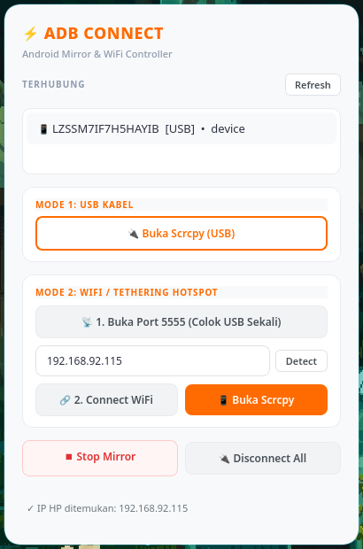

<h1 align="center">⚡ ADB Connect</h1>

<p align="center">
  <strong>GUI Controller Desktop Modern untuk Android ADB & Wireless scrcpy Mirroring</strong>
</p>

<p align="center">
  <a href="https://github.com/TheFoolByte/adb-connect/releases/latest"></a>
  
  
  
</p>

<p align="center">
  <a href="README.md">English</a> • <a href="README(id).md">Bahasa Indonesia</a>
</p>

<p align="center">
  
</p>

---

## 📖 Ringkasan

**ADB Connect** adalah aplikasi desktop GUI yang ringkas dan modern berbasis **PyQt6**. Mempermudah menghubungkan perangkat Android ke PC baik melalui kabel **USB** maupun **Wireless ADB (WiFi / Tethering Hotspot)**, lengkap dengan integrasi peluncur layar **scrcpy** yang otomatis menyesuaikan rasio aspek tampilan ponsel secara proporsional di layar monitor PC.

---

## ✨ Fitur Utama

- **🎨 Desain Card Modern**: Tampilan kartu putih bersih dengan aksen oranye terang (`#FF6B00`) yang ramah visual.
- **🔍 Deteksi IP Otomatis**: Mendeteksi alamat IP ponsel secara cerdas baik di jaringan WiFi (`wlan0`), hotspot tethering (`ap0`), maupun interface sekunder.
- **📐 Auto-Scale Adaptif scrcpy**: Mengambil resolusi fisik perangkat (`adb shell wm size`) lalu menyesuaikan ukuran jendela scrcpy ke ~70% tinggi monitor—layar proporsional tanpa distorsi atau stretch.
- **🔄 Dua Mode Koneksi**:
  - **Mode 1 (Kabel USB)**: Mirroring layar langsung dengan satu klik kabel USB.
  - **Mode 2 (WiFi / Hotspot)**: Buka port `5555` sekali colok, deteksi IP otomatis, pairing nirkabel, dan mirroring bebas kabel.
- **🛑 Kontrol Proses Terintegrasi**: Tombol **Stop Mirror** (`pkill scrcpy` / `taskkill`) dan **Disconnect All** (`adb disconnect`) instan.
- **🪟 Siap Tiling WM & Wayland**: Dukungan konfigurasi floating native untuk window manager seperti Hyprland.

---

## 📦 Installer & Rilis Windows

File installer binary untuk Windows tersedia di halaman [GitHub Releases](https://github.com/TheFoolByte/adb-connect/releases/latest):

| Paket | Deskripsi |
| :--- | :--- |
| **`ADBConnect-Installer-x64.exe`** | Setup installer yang otomatis terdaftar di Start Menu & Control Panel. |
| **`ADBConnect-Portable-x64.zip`** | Versi zip portabel tanpa proses instalasi. |

> *Catatan: Paket rilis Windows sudah membundel binary `adb` dan `scrcpy` siap pakai.*

---

## 📋 Kebutuhan Sistem (Linux)

Pastikan sistem Anda sudah terpasang Python 3.10+, ADB tools, dan scrcpy:

### Arch Linux
```bash
sudo pacman -S android-tools scrcpy python-pyqt6
```

### Ubuntu / Debian
```bash
sudo apt install adb scrcpy python3-pyqt6
```

### Fedora
```bash
sudo dnf install android-tools scrcpy python3-pyqt6
```

---

## 🚀 Panduan Penggunaan

### Menjalankan dari Source
```bash
# Clone repository
git clone https://github.com/TheFoolByte/adb-connect.git
cd adb-connect

# Jalankan aplikasi
python3 adb_gui_qt.py
```

### Panduan Koneksi Wireless (WiFi / Hotspot)
1. Sambungkan HP ke PC menggunakan kabel USB (pastikan opsi **USB Debugging** aktif).
2. Klik tombol **`📡 1. Buka Port 5555`** untuk membuka mode TCP/IP pada HP.
3. Klik tombol **`Detect`** untuk membaca IP HP secara otomatis.
4. Cabut kabel USB dari PC/HP.
5. Klik **`🔗 2. Connect WiFi`** untuk menghubungkan perangkat secara wireless.
6. Klik **`📱 Buka Scrcpy`** untuk mulai mirroring layar.

---

## ⚙️ Integrasi Hyprland (Opsional)

Tambahkan aturan berikut pada file konfigurasi Hyprland (`~/.config/hypr/configs/rules.lua` atau `hyprland.conf`) agar jendela aplikasi dan scrcpy otomatis melayang (floating):

```lua
hl.window_rule({ match = { class = "^(scrcpy)$" }, float = 1, center = 1 })
hl.window_rule({ match = { class = "^(ADBConnectWindow)$" }, float = 1, center = 1 })
```

---

## 👤 Author

- GitHub: [@TheFoolByte](https://github.com/TheFoolByte)
- Repository: [TheFoolByte/adb-connect](https://github.com/TheFoolByte/adb-connect)
